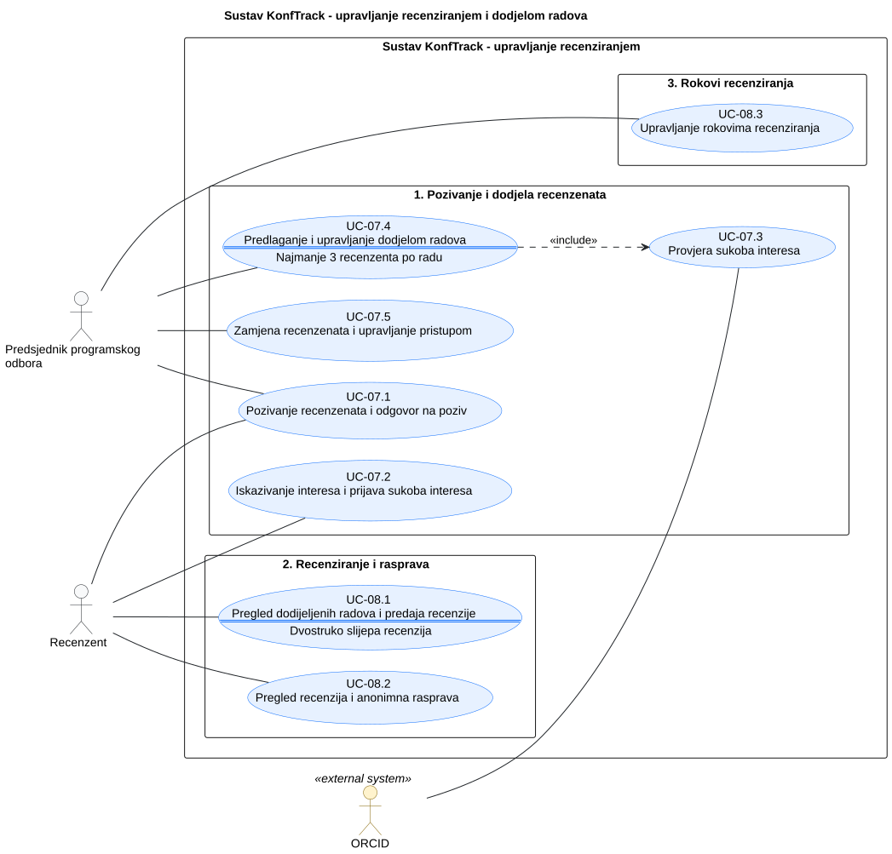
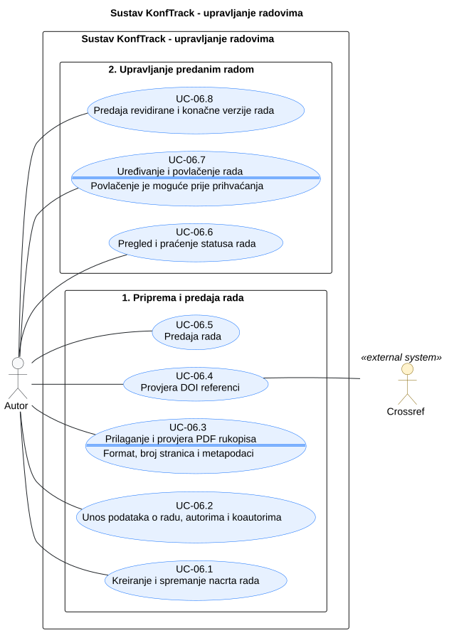
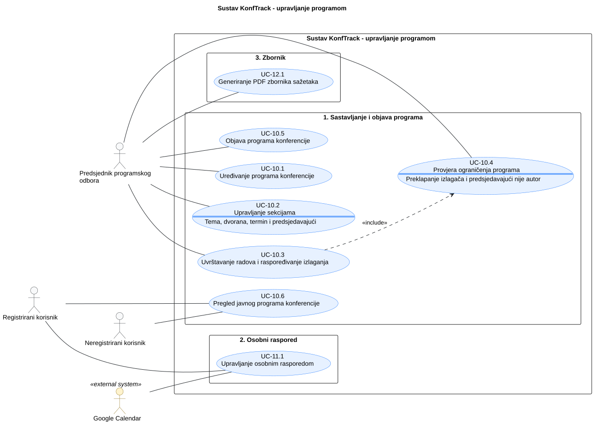

# 3. Obrasci uporabe

**Cilj:** Prikazati glavne interakcije između aktera aplikacije i sustava. Opišite kako akter ostvaruje cilj i što se događa kada važan korak ne uspije. Interakcije temeljite na odobrenim zahtjevima i ažurirajte ih kako se aplikacija razvija.

## 3.1 Dijagram obrazaca uporabe

**Cilj:** Prikazati granicu sustava, relevantne aktere i njihove glavne ciljeve u **preglednom UML dijagramu obrazaca uporabe**. Ako je za razumijevanje pojedinog dijela sustava potrebno prikazati više detalja, taj dio izdvojite u dodatni usmjereni dijagram. Dodatni dijagrami trebaju produbiti dio preglednog modela, a ne stvarati nepovezane ili duplicirane prikaze istog sustava.

Glavni dijagram obuhvaća registrirane i neregistrirane korisnike, posebne korisničke uloge te vanjske sustave s kojima aplikacija komunicira. Prikazane su glavne funkcionalnosti sustava i povezanost aktera s onima koje koriste. 
Zbog većeg broja funkcionalnosti, glavni dijagram ograničen je na pregled najvažnijih slučajeva uporabe. Složenije funkcionalne cjeline dodatno su razrađene zasebnim usmjerenim dijagramima kako bi se postigla preglednost i lakše razumijevanje. 

**Slika 3.1. Dijagram obrazaca uporabe sustava KonfTrack**

**PlantUML izvor:** [izvor](./puml/3-1-konftrack-system-UC.puml)

**Slika 3.2. Usmjereni dijagram obrazaca uporabe sustava KonfTrack - Upravljanje recenziranjem**

**PlantUML izvor:** [izvor](./puml/3-2-konftrack-recenziranje-UC.puml)

**Slika 3.3. Usmjereni dijagram obrazaca uporabe sustava KonfTrack - Upravljanje radovima**

**PlantUML izvor:** [izvor](./puml/3-3-konftrack-radovi-UC.puml)

**Slika 3.4. Usmjereni dijagram obrazaca uporabe sustava KonfTrack - Izrada programa**

**PlantUML izvor:** [izvor](./puml/3-4-konftrack-program-UC.puml)

**Provjera dijagrama:** Prikažite prepoznate uloge koje **komuniciraju s aplikacijom**, a ne dionike koji s njom nemaju interakciju. Svaki glavni korisnički cilj mora imati pridruženog aktera; uključeni obrazac uporabe može se dosegnuti preko drugog obrasca uporabe bez vlastite izravne veze s akterom. `<<include>>` i `<<extend>>` koristite samo kada odnos odgovara stvarnom ponašanju.

<strong>Primjer aktera i granica sustava</strong>

**Opis primjera — CrisisMap:**

Dijagram prikazuje **ogledni scenarij** s građaninom, posjetiteljem i koordinatorom pomoći te vanjskim pružateljem identiteta. Pružatelj identiteta sudjeluje u obrascu uporabe „Prijava u sustav” kao sekundarni akter: korisnik pokreće prijavu u aplikaciji, a vanjski sustav provodi autentikaciju. Budući da projekt koristi vanjskog pružatelja identiteta, ta se ovisnost prikazuje i u dijagramu obrazaca uporabe; tehnički detalji integracije pripadaju arhitekturnoj dokumentaciji.

**Odabir aktera i ciljeva:** Granica pokazuje što aplikacija nudi, akteri imaju različite ciljeve, a nijedan akter ni obrazac uporabe ne tvrdi da ova studentska aplikacija angažira hitne službe. Dijagram usporedite s odobrenim funkcijskim zahtjevima i akterima.

**Pet pitanja za odabir sadržaja dijagrama** (ne pet dijagrama za predaju):

| Fokus | Pitanje |
| --- | --- |
| Cijeli sustav | Koji korisnički ciljevi najbolje objašnjavaju čemu ova aplikacija služi? |
| Ključne funkcionalnosti | Koje ciljeve treba detaljnije opisati ili, ako je potrebno, prikazati zasebnim usmjerenim dijagramom? |
| Korisničke uloge | Koji akteri mogu sudjelovati u pojedinom cilju i kako se njihove ovlasti razlikuju? |
| Ključni procesi | Koji cilj ima važne alternative koje treba opisati u obrascu uporabe? |
| Vanjske integracije | Sudjeluje li drugi sustav u obrascu uporabe kao **sekundarni akter**, primjerice odobreni pružatelj identiteta pri prijavi? |

Vanjski sustav može biti sekundarni akter obrasca uporabe kada sudjeluje u ostvarenju korisničkog cilja; tehničke veze opisuju se u arhitekturi. Nemojte stvarati dodatni obavezni dijagram obrazaca uporabe samo radi popisa integracija. Prenatrpan dijagram podijelite prema povezanim akterima ili ciljevima samo kada time postaje čitljiviji.

## 3.2 Specifikacije obrazaca uporabe

**Cilj:** Za svaki obrazac uporabe iz dijagrama objasniti cilj aktera, uobičajenu interakciju s aplikacijom i važne alternative. Jednostavne obrasce uporabe opišite kratko; proširite one kod kojih alternative, vanjske ovisnosti ili posljedice zahtijevaju dodatno objašnjenje.

**Za svaki obrazac uporabe koristite jednu okomitu tablicu.** Navedite samo onoliko pojedinosti koliko interakcija zahtijeva; neprimjenjivu alternativu izostavite umjesto da je popunjavate samo radi forme.

### UC-[ID]: [Naziv usmjeren na cilj]

| Element specifikacije | Opis |
| :--- | :--- |
| **Primarni akter** | [Uloga definirana u analizi zahtjeva] |
| **Povezani zahtjevi** | [Identifikatori funkcijskih zahtjeva, npr. F-001, F-004] |
| **Preduvjeti** | [Stanje sustava koje mora biti zadovoljeno prije početka izvođenja] |
| **Glavni uspješni tok** | 1. Akter pokreće akciju. 2. Program obrađuje unos i vraća povratnu informaciju. 3. [Koračni prikaz interakcije do ostvarenja cilja] |
| **Alternativni tokovi / Iznimke** | **[Korak]a — [Naziv iznimke]:** [Uvjet nastanka, reakcija programa i nastavak toka] |
| **Posljedice (ishod)** | [Promjena stanja podataka ili potvrda nakon uspješnog završetka] |

### UC-[01]: [Registracija]

| Element specifikacije | Opis |
| :--- | :--- |
| **Primarni akter** | [Neregistrirani korisnik] |
| **Povezani zahtjevi** | [F-001] |
| **Preduvjeti** | [Korisnik nema postojeći korisnički račun u sustavu.] |
| **Glavni uspješni tok** |1. Neregistrirani korisnik odabire mogućnost registracije. 2. Aplikacija prikazuje dostupne načine registracije. 3. Korisnik odabire registraciju putem valjane adrese e-pošte ili ORCID računa. 4. Aplikacija obrađuje odabrani način registracije i provjerava podatke potrebne za stvaranje računa. 5. Ako je odabrana registracija putem ORCID-a, korisnik prolazi odgovarajući postupak autorizacije putem ORCID-a. 6. Aplikacija stvara korisnički račun i potvrđuje uspješnu registraciju. |
| **Alternativni tokovi / Iznimke** | **[3]a — [Nevaljana adresa e-pošte]:** [ Ako korisnik unese nevaljanu adresu e-pošte, aplikacija prikazuje obavijest i traži ispravak podatka.]  **[4]a — [odaci nisu prihvaćeni]:** [ Ako podaci potrebni za registraciju nisu valjani ili je račun već registriran, aplikacija obavještava korisnika i ne stvara novi račun.] tu?  **[5]a — [Neuspješna ORCID autorizacija]:** [Ako korisnik ne dovrši autorizaciju putem ORCID-a, registracija se ne dovršava.] |
| **Posljedice (ishod)** | [Korisnik je uspješno prijavljen u sustav i može pristupati funkcionalnostima koje odgovaraju njegovim dodijeljenim ulogama i ovlastima.] |

### UC-[02]: [Prijava u sustav]

| Element specifikacije | Opis |
| :--- | :--- |
| **Primarni akter** | [Registrirani korisnik] |
| **Povezani zahtjevi** | [F-002] |
| **Preduvjeti** | [Korisnik ima registrirani korisnički račun u sustavu.] |
| **Glavni uspješni tok** | 1. Registrirani korisnik odabire mogućnost prijave u sustav. 2. Aplikacija prikazuje dostupne načine prijave. 3. Korisnik odabire prijavu putem adrese e-pošte ili ORCID računa. 4. Aplikacija pokreće odgovarajući postupak autentifikacije i provjerava identitet korisnika. 5. Ako je odabrana prijava putem ORCID-a, korisnik prolazi autorizaciju putem ORCID-a. 6. Nakon uspješne autentifikacije aplikacija izdaje i koristi OAuth 2.0 tokene za autorizaciju pristupa te korisniku omogućuje pristup njegovu računu. |
| **Alternativni tokovi / Iznimke** | **[3]a — [Odabran neispravan način prijave]:** [Ako korisnik ne odabere ili ne može koristiti podržani način prijave, aplikacija ne pokreće autentifikaciju.]  **[4]a — [Neuspješna autentifikacija]:** [Ako identitet korisnika nije moguće potvrditi, aplikacija prikazuje obavijest o neuspješnoj prijavi i ne omogućuje pristup računu.]  **[5]a — [Neuspješna ORCID autorizacija]:** [Ako korisnik ne dovrši autorizaciju putem ORCID-a, prijava se ne dovršava.] |
| **Posljedice (ishod)** | [Korisnik je uspješno prijavljen u sustav i može pristupati funkcionalnostima koje odgovaraju njegovim dodijeljenim ulogama i ovlastima.] |

### UC-[03]: [Pregled javne stranice konferencije]

| Element specifikacije | Opis |
| :--- | :--- |
| **Primarni akter** | [Neregistrirani korisnik] |
| **Sekundarni akter** | [Registrirani korisnik] |
| **Povezani zahtjevi** | [F-009, F-012, F-063] |
| **Preduvjeti** | [Konferencija je odobrena, a njezini javno dostupni podaci objavljeni su u sustavu. Za pregled javne stranice nije potrebna prijava.] |
| **Glavni uspješni tok** |1. Korisnik otvara javnu stranicu konferencije. 2. Aplikacija prikazuje dostupne javne informacije o konferenciji, uključujući naziv, lokaciju, datume i teme. 3. Korisnik pregledava objavljene informacije o konferenciji. 4. Ako je program konferencije objavljen, aplikacija omogućuje njegov pregled, uključujući pripadajuće sekcije i izlaganja (UC-P10).|
| **Alternativni tokovi / Iznimke** | **[1]a — [Konferencija nije dostupna]:** [Ako tražena konferencija ne postoji ili njezina javna stranica nije dostupna, aplikacija prikazuje odgovarajuću obavijest.]  **[4]a — [Program nije objavljen]:** [Ako program konferencije još nije objavljen, aplikacija prikazuje ostale dostupne javne informacije bez prikaza programa.] |
| **Posljedice (ishod)** | [Korisnik je pregledao javno dostupne informacije o konferenciji i, ako je objavljen, njezin program. Ne dolazi do promjene podataka konferencije.] |

### UC-[04]: [Upravljanje profilom]

| Element specifikacije | Opis |
| :--- | :--- |
| **Primarni akter** | [Registrirani korisnik] |
| **Povezani zahtjevi** | [F-004] |
| **Preduvjeti** | [Korisnik je prijavljen u sustav.] |
| **Glavni uspješni tok** | 1. Korisnik otvara svoj korisnički profil. 2. Sustav prikazuje trenutačne podatke profila. 3. Korisnik unosi ili uređuje ime, prezime, instituciju, ORCID ID i ključne riječi koje opisuju njegovo područje stručnosti. 4. Korisnik potvrđuje promjene. 5. Sustav provjerava unesene podatke i sprema ažurirani profil. 6. Sustav prikazuje potvrdu o uspješnom spremanju promjena.|
| **Alternativni tokovi / Iznimke** | **[3]a — [Nepotpuni ili neispravni podaci]:** [Ako uneseni podaci nisu valjani ili nedostaju obvezni podaci, sustav obavještava korisnika i traži ispravak.]  **[5]a — [Neuspješno spremanje profila]:** [Ako sustav ne može spremiti promjene, obavještava korisnika da ažuriranje nije uspjelo.] |
| **Posljedice (ishod)** | [Korisnički profil uspješno je ažuriran i sadrži unesene podatke o korisniku, instituciji, ORCID identifikatoru i području stručnosti.] |

### UC-[06]: [Upravljanje korisnicima i postavkama platforme]

| Element specifikacije | Opis |
| :--- | :--- |
| **Primarni akter** | [Administrator sustava] |
| **Povezani zahtjevi** | [F-008, F-069, F-070] |
| **Preduvjeti** | [Administrator je prijavljen u sustav i ima administratorske ovlasti.] |
| **Glavni uspješni tok** |1. Administrator otvara administracijsko sučelje sustava. 2. Sustav prikazuje dostupne administracijske funkcionalnosti. 3. Administrator odabire upravljanje korisnicima. 4. Sustav prikazuje popis korisnika i njihove podatke. 5. Administrator odabire korisnički račun kojim želi upravljati. 6. Administrator može deaktivirati korisnički račun u slučaju zlouporabe sustava (F-008). 7. Administrator može uređivati predloške poruka elektroničke pošte koje sustav koristi za obavještavanje korisnika (F-069). 8. Administrator može pregledavati statističke podatke o korištenju platforme (F-070). 9. Sustav sprema provedene promjene i prikazuje odgovarajuću potvrdu. |
| **Alternativni tokovi / Iznimke** | **[4]a — [Korisnik nije pronađen]:** [Ako odabrani korisnički račun ne postoji, sustav obavještava administratora.]  **[6]a — [Deaktivacija nije moguća]:** [Ako deaktivaciju nije moguće provesti, sustav obavještava administratora o neuspjehu.]  **[7]a — [Neispravan predložak poruke]:** [Ako predložak nije ispravno unesen, sustav obavještava administratora i traži ispravak.] |
| **Posljedice (ishod)** | [Administrator može upravljati korisničkim računima, deaktivirati račune u slučaju zlouporabe, uređivati predloške poruka i pregledavati statističke podatke o korištenju platforme.] |

### UC-[06]: [Odobravanje konferencije i imenovanje predsjednika]

| Element specifikacije | Opis |
| :--- | :--- |
| **Primarni akter** | [Administrator sustava] |
| **Povezani zahtjevi** | [F-010] |
| **Preduvjeti** | [Administrator je prijavljen u sustav i ima administratorske ovlasti. Zahtjev za odobravanje nove konferencije zaprimljen je u sustavu] |
| **Glavni uspješni tok** |1. Administrator otvara pregled konferencija koje čekaju odobrenje. 2. Sustav prikazuje zaprimljene zahtjeve za nove konferencije. 3. Administrator odabire konferenciju koju želi pregledati. 4. Sustav prikazuje dostupne podatke o konferenciji. 5. Administrator provjerava podatke i odobrava konferenciju. 6. Administrator odabire korisnika kojem dodjeljuje ulogu predsjednika programskog odbora za tu konferenciju. 7. Sustav evidentira odobrenje konferencije i dodjeljuje odabranom korisniku odgovarajuću ulogu. 8. Sustav prikazuje potvrdu o uspješnom odobrenju i imenovanju predsjednika programskog odbora. |
| **Alternativni tokovi / Iznimke** | **[3]a — [Konferencija nije pronađena]:** [Ako odabrani zahtjev više nije dostupan, sustav obavještava administratora.]  **[5]a — [Konferencija nije odobrena]:** [Ako administrator ne odobri konferenciju, ona se ne aktivira za daljnje upravljanje.]  **[6]a — [Korisnik nije odabran]:** [ Ako administrator ne odabere korisnika za predsjednika programskog odbora, postupak imenovanja ne može se dovršiti.]|
| **Posljedice (ishod)** | [Konferencija je odobrena u sustavu, a odabranom korisniku dodijeljena je uloga predsjednika programskog odbora za tu konferenciju.] |

### UC-[07]: [Upravljanje konferencijom]

| Element specifikacije | Opis |
| :--- | :--- |
| **Primarni akter** | [Predsjednik programskog odbora] |
| **Povezani zahtjevi** | [F-011, F-013, F-014, F-015, F-016, F-017, F-018] |
| **Preduvjeti** | [Konferencija je odobrena u sustavu, a predsjedniku programskog odbora dodijeljena je odgovarajuća uloga za tu konferenciju.] |
| **Glavni uspješni tok** |1. Predsjednik programskog odbora otvara podatke konferencije. 2. Sustav prikazuje trenutačne podatke i postavke konferencije. 3. Predsjednik unosi ili uređuje naziv konferencije, lokaciju, datume održavanja i ostale osnovne podatke (F-011). 4. Predsjednik definira teme konferencije (F-017). 5. Predsjednik postavlja rokove za pojedine faze konferencije: predaju radova, recenziranje, obavještavanje autora i predaju konačnih verzija (F-013). 6. Sustav sprema unesene podatke i rokove te automatski onemogućuje odgovarajuće radnje nakon isteka pripadajućih rokova (F-014). 7. Predsjednik objavljuje javne informacije o konferenciji (F-018). 8. Sustav prikazuje potvrdu o uspješnom spremanju i objavi podataka.|
| **Alternativni tokovi / Iznimke** | **[3]a — [Neispravni podaci konferencije]:** [Ako uneseni podaci nisu valjani ili nedostaju obvezni podaci, sustav obavještava predsjednika i traži ispravak.]  **[5]a — [Nevaljan rok]:** [Ako uneseni rok nije valjan, sustav obavještava predsjednika i traži ispravak.]  **[6]a — [Produljenje roka]:** [Predsjednik odabire rok koji želi produljiti i unosi novi datum i vrijeme. Sustav ažurira rok te obavještava korisnike na koje produljenje utječe (F-015, F-016). Za produljenje roka za recenziranje primjenjuju se i UR-15: Produljenje roka za recenziranje te UR-16: Obavještavanje korisnika o produljenju roka.]|
| **Posljedice (ishod)** | [Podaci i postavke konferencije spremljeni su, definirani rokovi primjenjuju se na odgovarajuće aktivnosti, a javne informacije dostupne su na stranici konferencije ako su objavljene.] |

### UC-[08]: [Predaja rada]

| Element specifikacije | Opis |
| :--- | :--- |
| **Primarni akter** | [Autor] |
| **Povezani zahtjevi** | [F-019, F-020, F-021, F-022, F-023, F-024, F-025, F-026] |
| **Preduvjeti** | [SAutor je prijavljen u sustav i ima odgovarajuću ulogu za predaju rada na odabranoj konferenciji. Rok za predaju radova nije istekao.] |
| **Glavni uspješni tok** |1. Autor pokreće postupak predaje rada za odabranu konferenciju. 2. Sustav omogućuje izradu i spremanje nacrta rada (UC-A01). 3. Autor unosi metapodatke rada: naslov, sažetak, ključne riječi i temu (UC-A02). 4. Autor odabire koautore među postojećim korisnicima ili ih poziva unosom imena i adrese e-pošte (UC-A03). 5. Autor određuje korespondentnog autora rada (UC-A04). 6. Autor prilaže anonimiziranu PDF datoteku rada (UC-A05). 7. Sustav provjerava format datoteke i najveći dopušteni broj stranica (UC-A06). 8. Sustav provjerava metapodatke PDF datoteke i upozorava autora ako su u njima navedena imena autora (UC-A07). 9. Sustav provjerava DOI reference rada putem sustava Crossref te dohvaća dostupne metapodatke referenci (UC-A08, UC-21). 10. Autor potvrđuje predaju rada. 11. Sustav evidentira rad kao predan i prikazuje potvrdu o uspješnoj predaji (UC-A09).|
| **Alternativni tokovi / Iznimke** | **[3]a — [Nepotpuni metapodaci]:** [Ako nisu uneseni svi obvezni metapodaci, sustav obavještava autora i traži dopunu.]  **[4]a — [Koautor nije pronađen]:** [Autor može unijeti ime i adresu e-pošte osobe koju želi pozvati kao koautora.]  **[6]a — [Neodgovarajuća datoteka]:** [Ako datoteka nije u PDF formatu ili prelazi dopušteni broj stranica, sustav obavještava autora i ne dopušta nastavak predaje dok se problem ne ispravi.]  **[8]a — [Podaci o autorima u metapodacima PDF-a]:** [Sustav upozorava autora da datoteka možda nije u potpunosti anonimizirana. Autor može ispraviti datoteku prije predaje.]  **[9]a — [DOI referenca nije pronađena]:** [Sustav upozorava autora da za uneseni DOI nije pronađen odgovarajući zapis u Crossrefu.]  **[10]a — [Rok za predaju je istekao]:** [Sustav ne dopušta predaju rada nakon isteka roka.]|
| **Posljedice (ishod)** | [Rad je evidentiran u sustavu sa statusom „Predan”, zajedno s unesenim metapodacima, popisom autora i priloženom anonimiziranom PDF datotekom.] |

### UC-[09]: [Upravljanje vlastitim radovima]

| Element specifikacije | Opis |
| :--- | :--- |
| **Primarni akter** | [Autor] |
| **Povezani zahtjevi** | [F-027, F-028, F-029, F-030, F-031, F-032] |
| **Preduvjeti** | [Autor je prijavljen u sustav i ima najmanje jedan rad povezan sa svojim korisničkim računom.] |
| **Glavni uspješni tok** | 1. Autor otvara pregled vlastitih radova (UC-A10). 2. Sustav prikazuje radove povezane s autorom i njihove trenutačne statuse. 3. Autor odabire rad kojim želi upravljati. 4. Sustav, ovisno o statusu rada i rokovima konferencije, prikazuje dopuštene radnje. 5. Autor može urediti podatke predanog rada ako je uređivanje dopušteno (UC-A11). 6. Ako je za rad zatražena dorada, autor prilaže revidiranu verziju rada i dokument s odgovorima na recenzije (UC-A13, UC-A14). 7. Ako je rad prihvaćen, autor prilaže konačnu neanonimiziranu verziju, potpisanu izjavu o autorskim pravima i određuje izlagača rada (UC-A15, UC-A16, UC-A17). 8. Sustav sprema promjene i ažurira status rada u skladu s provedenom radnjom. |
| **Alternativni tokovi / Iznimke** | **[4]a — [Rad se ne može uređivati]:** [Ako je rad u postupku recenziranja, sustav ne dopušta njegovo uređivanje (UC-A11)]  **[4]b — [Povlačenje rada]:** [Autor može povući rad prije njegova prihvaćanja, uključujući i dok je rad u postupku recenziranja (UC-A12). Sustav evidentira povlačenje, zadržava zapis rada i obavještava recenzente o povlačenju (UC-A18).]  **[6]a — [Nepotpuna revidirana predaja]:** [Ako nisu priloženi revidirana verzija rada i dokument s odgovorima na recenzije, sustav obavještava autora i traži dopunu. Nakon uspješne predaje revidirana verzija vraća se u postupak recenziranja s istim recenzentima.]  **[7]a — [Nepotpuna konačna predaja]:** [Ako nedostaje konačna neanonimizirana verzija, potpisana izjava o autorskim pravima ili podatak o izlagaču, sustav obavještava autora i traži dopunu.]  **[7]b — [Rok za predaju konačne verzije je istekao]:** [Sustav ne dopušta predaju nakon isteka pripadajućeg roka.] |
| **Posljedice (ishod)** | [Autor može pregledavati vlastite radove i, ovisno o statusu rada i rokovima, uređivati ih, povući ih, predati revidiranu verziju ili predati konačnu verziju. Povučeni rad ostaje evidentiran u sustavu sa statusom „Povučen”.] |

### UC-[10]: [Upravljanje recenzentima]

| Element specifikacije | Opis |
| :--- | :--- |
| **Primarni akter** | [Predsjednik programskog odbora] |
| **Povezani zahtjevi** | [F-033] |
| **Preduvjeti** | [Predsjednik programskog odbora prijavljen je u sustav i ima odgovarajuće ovlasti za upravljanje recenzentima odabrane konferencije.] |
| **Glavni uspješni tok** |1. Predsjednik programskog odbora otvara dio sustava za upravljanje recenzentima. 2. Sustav prikazuje mogućnosti upravljanja pozivima u programski odbor. 3. Predsjednik unosi adresu e-pošte osobe koju želi pozvati kao recenzenta. 4. Predsjednik šalje poziv za sudjelovanje u programskom odboru konferencije (UR-01). 5. Sustav evidentira poslani poziv i šalje pozivnu poruku na unesenu adresu e-pošte. 6. Sustav omogućuje predsjedniku pregled statusa poslanih poziva. |
| **Alternativni tokovi / Iznimke** | **[3]a — [Nevaljana adresa e-pošte]:** [Sustav obavještava predsjednika da unesena adresa nije valjana i traži ispravak. ] **[3]b — [Osoba je već pozvana]:** [Ako za unesenu adresu već postoji aktivan poziv za istu konferenciju, sustav obavještava predsjednika i ne šalje ponovljeni poziv.] **[5]a — [Slanje poziva nije uspjelo]:** [Sustav obavještava predsjednika da poziv nije moguće poslati.] |
| **Posljedice (ishod)** | [Poziv za sudjelovanje u programskom odboru evidentiran je u sustavu i poslan potencijalnom recenzentu. Status poziva može se pratiti u sustavu.] |

### UC-[11]: [Prihvaćanje ili odbijanje poziva na recenziranje]

| Element specifikacije | Opis |
| :--- | :--- |
| **Primarni akter** | [Recenzent] |
| **Povezani zahtjevi** | [F-034] |
| **Preduvjeti** | [Recenzent je primio poziv za sudjelovanje u programskom odboru odabrane konferencije.] |
| **Glavni uspješni tok** |1. Recenzent otvara poziv za sudjelovanje u programskom odboru konferencije. 2. Sustav prikazuje podatke o konferenciji i sadržaj poziva. 3. Recenzent odabire mogućnost prihvaćanja poziva. 4. Sustav evidentira prihvaćanje poziva i dodjeljuje korisniku ulogu recenzenta za odabranu konferenciju. 5. Sustav prikazuje potvrdu o uspješnom prihvaćanju poziva. |
| **Alternativni tokovi / Iznimke** | **[3]a — [Odbijanje poziva]:** [Recenzent odabire mogućnost odbijanja poziva. Sustav evidentira odbijanje i ažurira status poziva.] **[3]b — [Poziv više nije dostupan]:** [Ako je poziv istekao ili više nije aktivan, sustav obavještava korisnika da odgovor nije moguće poslati.] |
| **Posljedice (ishod)** | [Poziv je evidentiran kao prihvaćen ili odbijen. Ako je recenzent prihvatio poziv, dodijeljena mu je uloga recenzenta za odabranu konferenciju.] |

### UC-[12]: [Iskazivanje interesa za recenziranje]

| Element specifikacije | Opis |
| :--- | :--- |
| **Primarni akter** | [Recenzent] |
| **Povezani zahtjevi** | [F-035, F-036] |
| **Preduvjeti** | [Recenzent je prihvatio poziv za sudjelovanje u programskom odboru i prijavljen je u sustav. Radovi za odabranu konferenciju predani su i dostupni za iskazivanje interesa.] |
| **Glavni uspješni tok** | 1. Recenzent otvara popis radova za koje može iskazati interes za recenziranje (UR-03). 2. Sustav prikazuje naslove i sažetke dostupnih radova. 3. Recenzent odabire rad i iskazuje svoj interes odabirom jedne od ponuđenih mogućnosti: „Želim recenzirati”, „Mogu recenzirati”, „Ne želim recenzirati” ili „Sukob interesa”. 4. Sustav evidentira odabranu mogućnost za pojedini rad. 5. Recenzent ponavlja postupak za ostale dostupne radove. 6. Sustav sprema iskazane interese recenzenta. |
| **Alternativni tokovi / Iznimke** | **[3]a — [Sukob interesa]:** [Recenzent odabire mogućnost „Sukob interesa” ako smatra da postoji razlog zbog kojeg ne bi trebao recenzirati odabrani rad (F-036). Sustav evidentira iskazani sukob interesa.]  **[3]b — [Rad više nije dostupan]:** [Ako rad više nije dostupan za iskazivanje interesa, sustav obavještava recenzenta.] |
| **Posljedice (ishod)** | [Sustav sadrži evidentirane iskaze interesa recenzenta za pojedine radove, koji se mogu koristiti prilikom predlaganja dodjele radova recenzentima.] |

### UC-[13]: [Dodjela radova recenzentima]

| Element specifikacije | Opis |
| :--- | :--- |
| **Primarni akter** | [Predsjednik programskog odbora] |
| **Povezani zahtjevi** | [F-037, F-038, F-039, F-040, F-041, F-042] |
| **Preduvjeti** | [Predsjednik programskog odbora prijavljen je u sustav i ima odgovarajuće ovlasti. Predaja radova je završena, a recenzenti su iskazali interes za recenziranje.] |
| **Glavni uspješni tok** |1. Predsjednik otvara funkcionalnost za dodjelu radova recenzentima 2. Sustav pokreće provjeru sukoba interesa za radove i recenzente (UR-04, UC-22).  3. Sustav automatski generira prijedlog dodjele radova recenzentima (UR-05), uzimajući u obzir iskazane interese, sukobe interesa i ravnomjernu raspodjelu opterećenja recenzenata (F-038). 4. Sustav provjerava ograničenja dodjele (UR-06): svaki rad mora imati najmanje tri recenzenta, a recenzent ne smije recenzirati vlastiti rad (F-038, F-042). 5. Sustav prikazuje prijedlog dodjele isključivo predsjedniku programskog odbora (F-039). 6. Predsjednik pregledava prijedlog i prema potrebi ručno mijenja dodijeljene recenzente (UR-07, F-041). 7. Sustav ponovno provjerava ograničenja dodjele. 8. Predsjednik potvrđuje dodjelu radova recenzentima (F-040). 9. Sustav evidentira potvrđene dodjele i omogućuje recenzentima pristup dodijeljenim radovima. |
| **Alternativni tokovi / Iznimke** | **[3]a — [Nije moguće pronaći odgovarajuće recenzente]:** [: Ako sustav ne može predložiti dodjelu koja zadovoljava ograničenja, obavještava predsjednika da je potrebna ručna izmjena prijedloga.]  **[4]a — [Nedovoljan broj recenzenata]:** [Ako rad nema najmanje tri dodijeljena recenzenta, sustav ne dopušta potvrđivanje dodjele.]  **[6]a — [Ručna izmjena dodjele]:** [Predsjednik mijenja dodjelu pojedinog rada. Sustav nakon izmjene ponovno provjerava sukobe interesa i ograničenja dodjele.]  **[7]a — [Dodjela krši ograničenja]:** [Ako recenzent ima sukob interesa ili bi rad imao manje od tri recenzenta, sustav obavještava predsjednika i ne dopušta potvrđivanje takve dodjele.] |
| **Posljedice (ishod)** | [Radovi su dodijeljeni recenzentima, pri čemu svaki rad ima najmanje tri recenzenta, dodjela poštuje ograničenja sukoba interesa i vlastitog autorstva, a opterećenje recenzenata nastoji se ravnomjerno rasporediti..] |

### UC-[14]: [Recenziranje rada]

| Element specifikacije | Opis |
| :--- | :--- |
| **Primarni akter** | [Recenzent] |
| **Povezani zahtjevi** | [F-043, F-044, F-045, F-046, F-047, F-050, F-051, F-052] |
| **Preduvjeti** | [Recenzent je prijavljen u sustav, rad mu je dodijeljen i rok za recenziranje nije istekao.] |
| **Glavni uspješni tok** |1. Recenzent otvara pregled svojih recenzija (UR-08). 2. Sustav prikazuje radove dodijeljene recenzentu i pripadajuće rokove. 3. Recenzent odabire rad koji želi recenzirati. 4. Sustav prikazuje anonimizirani rad bez podataka o autorima. 5. Recenzent pregledava rad i ispunjava obrazac recenzije (UR-09). 6. Recenzent unosi ocjenu rada od -3 do +3 i procjenu vlastite stručnosti za područje rada od 1 do 5. 7. Recenzent unosi komentar namijenjen autorima i zaseban povjerljivi komentar namijenjen programskom odboru. 8. Recenzent predaje recenziju. 9. Sustav sprema recenziju i evidentira vrijeme predaje. 10. Sustav šalje automatske podsjetnike recenzentima sedam i dva dana prije isteka roka (UR-10).|
| **Alternativni tokovi / Iznimke** | **[5]a — [Recenzija nije potpuna]:** [Ako nisu uneseni svi obvezni podaci recenzije, sustav obavještava recenzenta i traži dopunu.]  **[8]a — [Rok za recenziranje je istekao]:** [Sustav označava recenziju kao zakašnjelu (UR-11, F-051)]  **[8]b — [Zamjena recenzenta]:** [Ako recenzent ne preda recenziju u predviđenom roku, predsjednik programskog odbora može mu dodijeliti zamjenskog recenzenta (UR-12, F-052). Zamijenjeni recenzent gubi pristup radu i više ne može sudjelovati u recenziranju niti utjecati na odluku o radu (F-043, F-044). ]  **[8]c— [Rok za recenziranje je produljen]:** [Ako je predsjednik produljio rok, sustav primjenjuje novi rok i obavještava pogođene korisnike.]  **[10]a — [Automatsko zatvaranje predaje]:** [Uvjet nastanka, reakcija programa i nastavak toka] |
| **Posljedice (ishod)** | [Recenzija je spremljena i povezana s pripadajućim radom. Sadrži ocjenu, procjenu stručnosti, komentar za autore i povjerljivi komentar za programski odbor. Identitet autora nije dostupan recenzentu, a identitet recenzenta nije dostupan autorima.] |

### UC-[15]: [Sudjelovanje u anonimnoj raspravi]

| Element specifikacije | Opis |
| :--- | :--- |
| **Primarni akter** | [Recenzent] |
| **Povezani zahtjevi** | [F-048, F-049] |
| **Preduvjeti** | [Recenzent je prijavljen u sustav, dodijeljen mu je odabrani rad i sve recenzije tog rada su predane.] |
| **Glavni uspješni tok** |1. Recenzent otvara rad za koji je završeno prikupljanje recenzija. 2. Sustav provjerava jesu li sve recenzije za odabrani rad predane. 3. Sustav prikazuje recenzije ostalih recenzenata uz vlastitu recenziju (UR-13). 4. Sustav prikazuje recenzente pod anonimnim oznakama, primjerice „Recenzent 1”, „Recenzent 2” i „Recenzent 3”. 5. Recenzent pregledava ostale recenzije i sudjeluje u raspravi o radu (UR-14). 6. Sustav sprema poruke i prikazuje ih ostalim recenzentima dodijeljenima tom radu.|
| **Alternativni tokovi / Iznimke** | **[2]a — [Nisu predane sve recenzije]:** [Ako barem jedna recenzija još nije predana, sustav ne omogućuje pregled recenzija drugih recenzenata ni sudjelovanje u raspravi.]  **[5]a — [Recenzent nema pristup raspravi]:** [Ako korisniku rad više nije dodijeljen, sustav mu ne dopušta pristup raspravi.|
| **Posljedice (ishod)** | [Recenzenti mogu pregledavati međusobne recenzije i sudjelovati u raspravi o radu, pri čemu su njihovi stvarni identiteti skriveni i prikazani anonimnim oznakama.] |

### UC-[16]: [Donošenje odluka o radovima]

| Element specifikacije | Opis |
| :--- | :--- |
| **Primarni akter** | [Predsjednik programskog odbora] |
| **Povezani zahtjevi** | [F-053, F-054, F-055, F-056] |
| **Preduvjeti** | [Predsjednik programskog odbora prijavljen je u sustav i ima odgovarajuće ovlasti. Recenzije za radove su predane i dostupne za donošenje odluka.] |
| **Glavni uspješni tok** |1. Predsjednik otvara pregled radova za koje je potrebno donijeti odluku. 2. Sustav prikazuje tablicu radova s prosječnom ocjenom, brojem predanih recenzija i oznakom značajnog neslaganja među recenzentima (F-053). 3. Predsjednik odabire rad koji želi pregledati. 4. Sustav prikazuje recenzije rada, uključujući komentare namijenjene autorima, ali ne prikazuje povjerljive komentare programskog odbora autorima. 5. Predsjednik pregledava recenzije i donosi odluku: prihvaćanje rada, zahtjev za doradu ili odbijanje rada (F-054). 6. Predsjednik potvrđuje odluku. 7. Sustav priprema obavijest autorima koristeći predložak poruke 8. Predsjednik pokreće slanje obavijesti svim autorima rada jednom radnjom (F-055). 9. Sustav šalje obavijesti koje sadrže odluku i recenzije, bez povjerljivih komentara programskog odbora (F-056).|
| **Alternativni tokovi / Iznimke** | **[2]a — [Recenzije nisu potpune]:** [Ako za rad još nisu predane sve potrebne recenzije, sustav ga ne prikazuje kao spremnog za donošenje konačne odluke.]  **[5]a — [Odluka nije odabrana]:** [Ako predsjednik nije odabrao jednu od ponuđenih odluka, sustav ne dopušta potvrđivanje odluke.]  **[8]a — [Slanje obavijesti nije uspjelo]:** [Ako sustav ne može poslati obavijesti svim autorima, obavještava predsjednika o neuspješnom slanju.] |
| **Posljedice (ishod)** | [Za rad je evidentirana odluka predsjednika programskog odbora: prihvaćen, potrebna dorada ili odbijen. Svim autorima rada poslana je obavijest s odlukom i recenzijama, bez povjerljivih komentara programskog odbora.] |

### UC-[17]: [Pregled statistike konferencije]

| Element specifikacije | Opis |
| :--- | :--- |
| **Primarni akter** | [Predsjednik programskog odbora] |
| **Povezani zahtjevi** | [F-067, F-068] |
| **Preduvjeti** | [Predsjednik programskog odbora prijavljen je u sustav i ima odgovarajuće ovlasti za pregled statistike odabrane konferencije.] |
| **Glavni uspješni tok** |1. Predsjednik otvara statistički pregled konferencije. 2. Sustav prikuplja i prikazuje statističke podatke o konferenciji. 3. Sustav prikazuje broj predanih radova prema temama, stopu prihvaćanja radova, prosječno trajanje recenziranja i opterećenje recenzenata (F-067). 4. Predsjednik pregledava prikazane statističke podatke. 5. Predsjednik odabire mogućnost izvoza statistike. 6. Sustav generira datoteku u CSV formatu i omogućuje njezino preuzimanje (F-068).|
| **Alternativni tokovi / Iznimke** | **[2]a — [Nema dostupnih statističkih podataka]:** [Ako za odabranu konferenciju još nema podataka za izračun pojedine statistike, sustav prikazuje dostupne podatke i označava da ostali podaci nisu dostupni.]  **[6]a — [Izvoz nije uspio]:** [Ako sustav ne može generirati CSV datoteku, obavještava predsjednika o neuspješnom izvozu.]  |
| **Posljedice (ishod)** | [Predsjednik je pregledao statističke podatke konferencije i, prema potrebi, preuzeo CSV datoteku sa statistikom.] |

### UC-[18]: [Upravljanje programom konferencije]

| Element specifikacije | Opis |
| :--- | :--- |
| **Primarni akter** | [Predsjednik programskog odbora] |
| **Povezani zahtjevi** | [F-057, F-058, F-059, F-060, F-061, F-062, F-063] |
| **Preduvjeti** | [Predsjednik programskog odbora prijavljen je u sustav i ima odgovarajuće ovlasti. Za konferenciju postoje prihvaćeni radovi s predanim konačnim verzijama.] |
| **Glavni uspješni tok** |1. Predsjednik otvara funkcionalnost za sastavljanje programa konferencije (UC-P01). 2. Sustav prikazuje radove dostupne za uvrštavanje u program. 3. Predsjednik upravlja sekcijama konferencije (UC-P02) i unosi njihove podatke: temu, prostoriju, vrijeme održavanja i predsjedavajućeg sekcije (UC-P03). 4. Predsjednik odabire radove koje želi uvrstiti u pojedine sekcije (UC-P04). 5. Sustav može predložiti grupiranje radova prema temama i ključnim riječima (UC-P05). 6. Sustav provjerava preklapanje termina izlaganja istog izlagača (UC-P06). 7. Sustav provjerava je li predsjedavajući sekcije autor rada koji je uvršten u tu sekciju (UC-P07). 8. Nakon uspješnih provjera sustav mijenja status uvrštenih radova u „Uvršten u program” (UC-P08, F-062). 9. Predsjednik objavljuje program konferencije (UC-P09). 10. Sustav prikazuje potvrdu o objavi programa i čini ga dostupnim na javnoj stranici konferencije (F-063).|
| **Alternativni tokovi / Iznimke** | **[3]a — [Nepotpuni podaci sekcije]:** [Ako nisu uneseni svi potrebni podaci sekcije, sustav obavještava predsjednika i traži dopunu]  **[5]a — [ Predloženo grupiranje nije prihvaćeno]:** [Predsjednik može samostalno odabrati raspored radova po sekcijama]  **[6]a — [Preklapanje termina izlagač]:** [Ako isti izlagač ima dva izlaganja u istom terminu, sustav upozorava predsjednika i traži izmjenu rasporeda.]  **[7]a — [Predsjedavajući je autor rada]:** [Ako je predsjedavajući sekcije autor rada u toj sekciji, sustav upozorava predsjednika i traži odabir drugog predsjedavajućeg ili izmjenu rasporeda.]  **[9]a — [Program nije moguće objaviti]:** [Ako program nije potpun ili postoje neriješena ograničenja, sustav obavještava predsjednika i ne objavljuje program.] |
| **Posljedice (ishod)** | [Program konferencije sastavljen je od sekcija i pripadajućih izlaganja, provjerena su ograničenja rasporeda, a uvrštenim radovima dodijeljen je status „Uvršten u program”. Objavljeni program dostupan je na javnoj stranici konferencije.] |

### UC-[19]: [Upravljanje osobnim rasporedom]

| Element specifikacije | Opis |
| :--- | :--- |
| **Primarni akter** | [Registrirani korisnik] |
| **Povezani zahtjevi** | [F-064, F-065] |
| **Preduvjeti** | [Korisnik je prijavljen u sustav, a program konferencije je objavljen.] |
| **Glavni uspješni tok** |1. Korisnik otvara objavljeni program konferencije (UC-P10). 2. Sustav prikazuje sekcije i izlaganja objavljenog programa. 3. Korisnik odabire izlaganja koja želi dodati u svoj osobni raspored (UC-P11). 4. Sustav sprema odabrana izlaganja u osobni raspored korisnika. 5. Korisnik odabire mogućnost izvoza osobnog rasporeda u Google Calendar (UC-P12). 6. Sustav priprema podatke o odabranim izlaganjima i omogućuje njihov izvoz u Google Calendar.|
| **Alternativni tokovi / Iznimke** | **[2]a — [Program nije objavljen]:** [Ako program konferencije još nije objavljen, sustav obavještava korisnika da izlaganja nisu dostupna za dodavanje u osobni raspored]  **[3]a — [Izlaganje je već dodano]:** [Ako se izlaganje već nalazi u osobnom rasporedu, sustav ne dodaje duplikat.]br> **[6]a — [Izvoz nije uspio]:** [Ako izvoz u Google Calendar nije moguće dovršiti, sustav obavještava korisnika o neuspješnom izvozu.] |
| **Posljedice (ishod)** | [Korisnik ima spremljen osobni raspored s odabranim izlaganjima i može ga izvesti u Google Calendar.] |

### UC-[20]: [Generiranje zbornika radova]

| Element specifikacije | Opis |
| :--- | :--- |
| **Primarni akter** | [Sustav KonfTrack(automatski proces)] |
| **Povezani zahtjevi** | [F-066] |
| **Preduvjeti** | [Za konferenciju postoje prihvaćeni radovi s dostupnim sažecima i podacima potrebnima za izradu zbornika. Dostupni su podaci o sekcijama i autorima.] |
| **Glavni uspješni tok** |1. Sustav pokreće postupak automatskog generiranja zbornika konferencije. 2. Sustav prikuplja sažetke prihvaćenih radova. 3. Sustav organizira sadržaj zbornika prema sekcijama konferencije (UC-P14). 4. Sustav generira kazalo autora (UC-P14). 5. Sustav izrađuje zbornik u PDF formatu. 6. Sustav evidentira generirani zbornik i omogućuje njegovu dostupnost u sustavu.|
| **Alternativni tokovi / Iznimke** | **[2]a — [Nedostaju podaci o prihvaćenim radovima]:** [Ako za neki prihvaćeni rad nedostaje sažetak ili drugi potreban podatak, sustav ne može u potpunosti generirati zbornik i evidentira problem]  **[5]a — [Generiranje PDF-a nije uspjelo]:** [Ako sustav ne može izraditi PDF datoteku, evidentira neuspjeh generiranja.] |
| **Posljedice (ishod)** | [Generiran je PDF zbornik sa sažecima prihvaćenih radova, organiziran prema sekcijama konferencije i s izrađenim kazalom autora.

### UC-[21]: [Provjera DOI referenci]

| Element specifikacije | Opis |
| :--- | :--- |
| **Primarni akter** | [Autor] |
| **Povezani zahtjevi** | [F-026] |
| **Preduvjeti** | [Autor predaje rad i unio je DOI reference koje je potrebno provjeriti.] |
| **Glavni uspješni tok** |1. Tijekom predaje rada sustav preuzima unesene DOI reference (UC-A08). 2. Sustav šalje upite vanjskom sustavu Crossref za provjeru DOI identifikatora. 3. Crossref vraća podatke o pronađenim DOI zapisima. 4. Sustav dohvaća dostupne metapodatke referenci. 5. Sustav prikazuje autoru rezultate provjere DOI referenci i dostupne metapodatke. |
| **Alternativni tokovi / Iznimke** | **[2]a — [Crossref nije dostupan]:** [Ako vanjski sustav Crossref ne odgovara, sustav obavještava autora da provjeru nije moguće dovršiti.]  **[3]a — [DOI referenca nije pronađena]:** [Ako Crossref ne pronađe zapis za uneseni DOI, sustav upozorava autora da referenca nije pronađena]  **[3]b — [ 3b — DOI referenca nije valjana]:** [Ako uneseni DOI nije u odgovarajućem obliku, sustav obavještava autora o neispravnom unosu.] |
| **Posljedice (ishod)** | [DOI reference rada provjerene su putem Crossrefa, dostupni metapodaci dohvaćeni su, a autor je upozoren na DOI reference za koje nije pronađen odgovarajući zapis.a] |

### UC-[22]: [Provjera sukoba interesa]

| Element specifikacije | Opis |
| :--- | :--- |
| **Primarni akteri** | [Sustav KonfTrack automatski pokreće provjeru; vanjski sustav ORCID sudjeluje dostavljanjem dostupnih podataka.] |
| **Povezani zahtjevi** | [F-037] |
| **Preduvjeti** | [U tijeku je postupak predlaganja ili provjere dodjele radova recenzentima. Dostupni su podaci o autorima i koautorima rada te podaci o recenzentima.] |
| **Glavni uspješni tok** |1. Sustav pokreće automatsku provjeru sukoba interesa za pojedini rad i potencijalne recenzente (UR-04). 2. Sustav dohvaća dostupne podatke o institucijama i prethodnoj suradnji putem ORCID-a. 3. Sustav provjerava pripada li recenzent istoj instituciji kao neki od autora ili koautora rada. 4. Sustav provjerava postoji li suradnja recenzenta s nekim od autora ili koautora u posljednje tri godine. 5. Sustav evidentira utvrđene sukobe interesa. 6. Sustav koristi rezultate provjere pri predlaganju i provjeri dodjele radova recenzentima (UC-13).|
| **Alternativni tokovi / Iznimke** | **[2]a — [Podaci nisu dostupni]:** [Ako ORCID ne dostavi potrebne podatke, sustav ne može provesti odgovarajuću automatsku provjeru na temelju tih podataka]  **[3]a — [Utvrđena ista institucija]:** [Ako recenzent pripada istoj instituciji kao neki od autora ili koautora rada, sustav evidentira sukob interesa.]  **[4]a — [Utvrđena nedavna suradnja]:** [Ako je recenzent surađivao s nekim od autora ili koautora u posljednje tri godine, sustav evidentira sukob interesa.] |
| **Posljedice (ishod)** | [Sustav je proveo provjeru sukoba interesa i evidentirao rezultate koji se uzimaju u obzir pri dodjeli radova recenzentima.] |

<strong>Primjeri specifikacija: Registracija i prijava kriznog događaja</strong>

**Primjer — CrisisMap:**

**UC-001: Registracija računa.** Ovaj kratki primjer odnosi se na projekt čiji odobreni zadatak uključuje račune s adresom e-pošte i lozinkom.

| Polje | Opis |
| --- | --- |
| Primarni akter | Građanin (A-02 u primjeru) |
| ID zahtjeva | F-001 |
| Preduvjeti, ako postoje | Nema. |
| Glavni tijek | Građanin unosi adresu e-pošte; aplikacija šalje poveznicu za potvrdu; građanin potvrđuje račun. |
| Alternativni ili neuspješni tijekovi, ako postoje | Adresa e-pošte već postoji → aplikacija objašnjava zašto se registracija ne može nastaviti. |
| Rezultat | Račun je aktivan nakon potvrde. |

Ako odobreni zadatak umjesto toga koristi isključivo OAuth prijavu, zamijenite ovaj primjer odgovarajućim ponašanjem prijave; nemojte dodavati registraciju lokalnom lozinkom samo radi podudaranja s primjerom.

**UC-002: Podnošenje prijave kriznog događaja.** Ista polja mogu opisati dulji tijek u kojem odabir lokacije, provjera valjanosti i pohrana mogu ne uspjeti.

| Polje | Opis |
| --- | --- |
| Primarni akter | Građanin |
| ID zahtjeva | F-004 |
| Preduvjeti, ako postoje | Obrazac za prijavu dostupan je. Ako odobreni zadatak zahtijeva prijavu u sustav, građanin je prijavljen. |
| Glavni tijek | 1. Građanin otvara obrazac za prijavu; aplikacija prikazuje polja za vrstu kriznog događaja, razinu ozbiljnosti, opis i lokaciju. 2. Građanin unosi podatke i odabire lokaciju na karti ili drugim podržanim načinom. 3. Građanin podnosi obrazac; aplikacija provjerava obavezna polja i lokaciju. 4. Aplikacija pohranjuje prijavu i prikazuje potvrdu s referencom na nju. |
| Alternativni ili neuspješni tijekovi, ako postoje | **1a — Prijava u sustav nije uspjela:** Ako je prijava obavezna, a pružatelj identiteta je ne dovrši, prijava kriznog događaja ostaje nepodnesena i aplikacija objašnjava kako pokušati ponovno. **2a — Odbijen pristup lokaciji:** Ako aplikacija nudi geolokaciju, ali je korisnik odbije, građanin ručno odabire lokaciju ako ta mogućnost postoji; tijek se nastavlja u koraku 3. **3a — Nevaljana ili nedostajuća lokacija:** Aplikacija objašnjava problem, po mogućnosti zadržava unesene podatke i ne pohranjuje prijavu; građanin ispravlja lokaciju i ponavlja korak 3. **3b — Pohrana nije uspjela:** Aplikacija prijavljuje neuspjeh i ne prikazuje lažnu potvrdu o podnošenju. |
| Rezultat | Aplikacija pohranjuje prijavu kriznog događaja i potvrđuje njezino podnošenje. |

**Odabir razine detalja:** Oba primjera koriste ista polja. UC-001 je kratak jer je glavna iznimka jasna; UC-002 zahtijeva numerirane korake i alternative jer oni mijenjaju ishod i mogu usmjeravati ispitivanje.Pri prilagodbi primjera koristite ID-ove zahtjeva i ponašanje vlastite aplikacije.

**UC-005: Moderiranje prijave kriznog događaja.** Ovaj primjer vrijedi samo za projekt u kojem odobreni opseg uključuje moderatorski pregled prijava.

| Polje | Opis |
| --- | --- |
| Primarni akter | Moderator (A-05 u primjeru) |
| ID zahtjeva | F-008 |
| Preduvjeti, ako postoje | Moderator je prijavljen i ima moderatorske ovlasti; postoji prijava koja čeka pregled. |
| Glavni tijek | 1. Moderator otvara prijavu koja čeka pregled. 2. Aplikacija prikazuje podatke prijave i dostupne moderatorske radnje. 3. Moderator odabire odobravanje ili odbijanje. 4. Aplikacija provjerava ovlasti, mijenja status prijave i prikazuje novi status. |
| Alternativni ili neuspješni tijekovi, ako postoje | **3a — Radnja nije potvrđena:** Moderator odustaje od promjene i prijava ostaje nepromijenjena. **4a — Ovlasti nisu valjane:** Aplikacija odbija promjenu i status prijave ostaje nepromijenjen. |
| Rezultat | Prijava ima novi status ako je moderatorska radnja uspješno provedena; inače ostaje nepromijenjena. |

---

## 3.3 Provjera dosljednosti obrazaca uporabe

**Cilj:** Provjeriti međusobnu usklađenost obrazaca uporabe, aktera, zahtjeva i ispitnih slučajeva. Cjelovito mapiranje održava se isključivo u **[matrici sljedivosti zahtjeva](2-Analiza-zahtjeva.md#26-sljedivost-zahtjeva)**.

| Provjera | Pitanje za tim |
| --- | --- |
| Zahtjev | Je li svaki važan obrazac uporabe povezan s postojećim zahtjevom? |
| Akter | Odgovara li akter naveden ovdje prethodno utvrđenoj ulozi i dopuštenoj interakciji? |
| Aplikacija | Može li tim demonstrirati opisani glavni rezultat i važnu alternativu ili je opis jasno označen kao trenutačno oblikovanje? |

---

Povezivanje zahtjev → obrazac uporabe → ispitivanje održavajte **samo jednom, u [tablici sljedivosti zahtjeva](./2-Analiza-zahtjeva.md)**. Ovdje nemojte održavati drugu projektnu tablicu mapiranja ni stupac sa statusom implementacije. Ako važan zahtjev nema interakciju s ljudskim akterom, objasnite gdje se obrađuje umjesto izmišljanja aktera.

<strong>Provjera pokrivenosti zahtjeva</strong>

**Primjer — CrisisMap:** Tablica pokrivenosti obrazaca uporabe koju treba analizirati:

| Broj obrasca uporabe | Naziv obrasca uporabe | Obuhvaćeni funkcijski zahtjevi |
| --- | --- | --- |
| UC-001 | Registracija računa | F-001: Registracija računa putem e-pošte |
| UC-002 | Prijava kriznog događaja | F-022: Prijava i provjera kriznog događaja |
| UC-003 | Sustav upozorenja | F-045: Slanje upozorenja korisnicima i timovima |
| UC-004 | Koordinacija spašavanja | F-067: Koordinacija s hitnim službama |

---

**Problemi pokrivenosti koje treba riješiti:**

- **Pogrešan ID zahtjeva:** ova tablica povezuje UC-002 s F-022, dok se opis UC-002 u odjeljku 3.2 poziva na F-004, zahtjev za podnošenje prijave iz odjeljka 2.1.
- **Zahtjevi koji ne postoje:** F-022, F-045 i F-067 nisu definirani u oglednim zahtjevima u 2.1.
- **Obrasci uporabe bez opisa:** UC-003 i UC-004 nemaju opis u 3.2. UC-004 (koordinacija s hitnim službama) ujedno je mogućnost s vanjskim posljedicama koju opseg dopušta samo ako je uključena u odobreni zadatak.
- **Nesklad aktera:** primjer aktera u odjeljku 2.3 navodi da koordinator pomoći podnosi prijave (F-004), dok UC-002 kao primarnog aktera navodi građanina.

**Završna provjera:** Dijagram, specifikacije obrazaca uporabe i matrica sljedivosti međusobno su usklađeni. Svaki važan obrazac uporabe povezan je s postojećim zahtjevom, akteri odgovaraju stvarnim ulogama u aplikaciji, a opisani glavni i alternativni tijekovi odgovaraju ponašanju koje sustav stvarno podržava.
