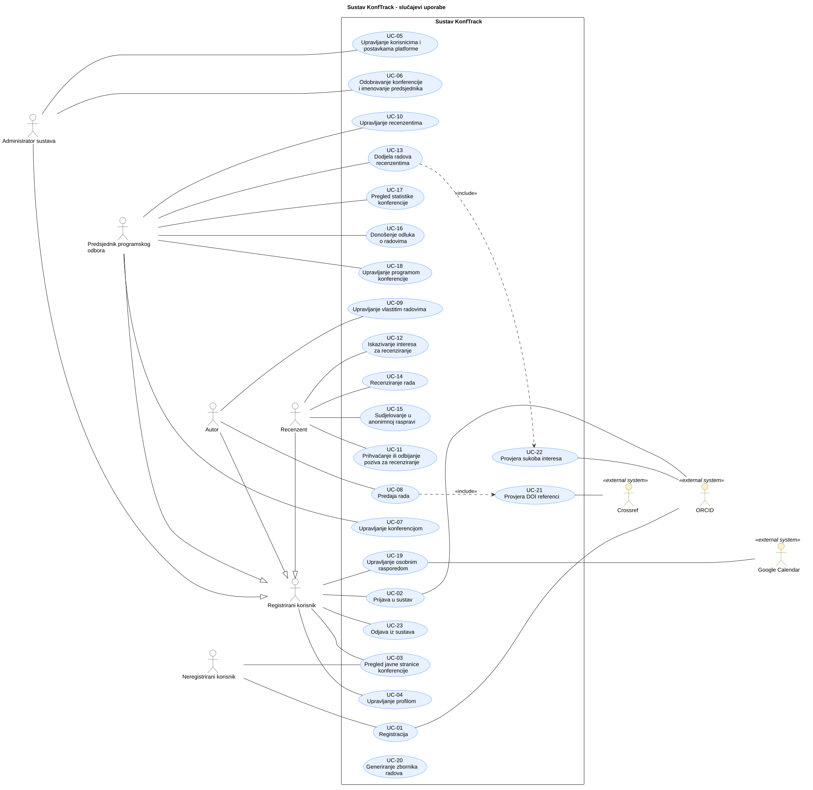

# 3. Obrasci uporabe

**Cilj:** Prikazati glavne interakcije između aktera aplikacije i sustava. Opišite kako akter ostvaruje cilj i što se događa kada važan korak ne uspije. Interakcije temeljite na odobrenim zahtjevima i ažurirajte ih kako se aplikacija razvija.

## 3.1 Dijagram obrazaca uporabe

**Cilj:** Prikazati granicu sustava, relevantne aktere i njihove glavne ciljeve u **preglednom UML dijagramu obrazaca uporabe**. Ako je za razumijevanje pojedinog dijela sustava potrebno prikazati više detalja, taj dio izdvojite u dodatni usmjereni dijagram. Dodatni dijagrami trebaju produbiti dio preglednog modela, a ne stvarati nepovezane ili duplicirane prikaze istog sustava.

Glavni dijagram obuhvaća registrirane i neregistrirane korisnike, posebne korisničke uloge te vanjske sustave s kojima aplikacija komunicira. Prikazane su glavne funkcionalnosti sustava i povezanost aktera s onima koje koriste.
Zbog većeg broja funkcionalnosti, glavni dijagram ograničen je na pregled najvažnijih slučajeva uporabe. Složenije funkcionalne cjeline dodatno su razrađene zasebnim usmjerenim dijagramima kako bi se postigla preglednost i lakše razumijevanje.

**Slika 3.1. Dijagram obrazaca uporabe sustava KonfTrack**

**PlantUML izvor:** [izvor](./puml/3-1-konftrack-system-UC.puml)

**Slika 3.2. Usmjereni dijagram obrazaca uporabe sustava KonfTrack - Upravljanje recenziranjem**

**PlantUML izvor:** [izvor](./puml/3-2-konftrack-recenziranje-UC.puml)

**Slika 3.3. Usmjereni dijagram obrazaca uporabe sustava KonfTrack - Upravljanje radovima**

**PlantUML izvor:** [izvor](./puml/3-3-konftrack-radovi-UC.puml)

**Slika 3.4. Usmjereni dijagram obrazaca uporabe sustava KonfTrack - Izrada programa**

**PlantUML izvor:** [izvor](./puml/3-4-konftrack-program-UC.puml)

**Provjera dijagrama:** Prikažite prepoznate uloge koje **komuniciraju s aplikacijom**, a ne dionike koji s njom nemaju interakciju. Svaki glavni korisnički cilj mora imati pridruženog aktera; uključeni obrazac uporabe može se dosegnuti preko drugog obrasca uporabe bez vlastite izravne veze s akterom. `<<include>>` i `<<extend>>` koristite samo kada odnos odgovara stvarnom ponašanju.

<strong>Primjer aktera i granica sustava</strong>

**Opis primjera — CrisisMap:**

Dijagram prikazuje **ogledni scenarij** s građaninom, posjetiteljem i koordinatorom pomoći te vanjskim pružateljem identiteta. Pružatelj identiteta sudjeluje u obrascu uporabe „Prijava u sustav” kao sekundarni akter: korisnik pokreće prijavu u aplikaciji, a vanjski sustav provodi autentikaciju. Budući da projekt koristi vanjskog pružatelja identiteta, ta se ovisnost prikazuje i u dijagramu obrazaca uporabe; tehnički detalji integracije pripadaju arhitekturnoj dokumentaciji.

**Odabir aktera i ciljeva:** Granica pokazuje što aplikacija nudi, akteri imaju različite ciljeve, a nijedan akter ni obrazac uporabe ne tvrdi da ova studentska aplikacija angažira hitne službe. Dijagram usporedite s odobrenim funkcijskim zahtjevima i akterima.

**Pet pitanja za odabir sadržaja dijagrama** (ne pet dijagrama za predaju):

| Fokus                   | Pitanje                                                                                                                     |
| ----------------------- | --------------------------------------------------------------------------------------------------------------------------- |
| Cijeli sustav           | Koji korisnički ciljevi najbolje objašnjavaju čemu ova aplikacija služi?                                                    |
| Ključne funkcionalnosti | Koje ciljeve treba detaljnije opisati ili, ako je potrebno, prikazati zasebnim usmjerenim dijagramom?                       |
| Korisničke uloge        | Koji akteri mogu sudjelovati u pojedinom cilju i kako se njihove ovlasti razlikuju?                                         |
| Ključni procesi         | Koji cilj ima važne alternative koje treba opisati u obrascu uporabe?                                                       |
| Vanjske integracije     | Sudjeluje li drugi sustav u obrascu uporabe kao **sekundarni akter**, primjerice odobreni pružatelj identiteta pri prijavi? |

Vanjski sustav može biti sekundarni akter obrasca uporabe kada sudjeluje u ostvarenju korisničkog cilja; tehničke veze opisuju se u arhitekturi. Nemojte stvarati dodatni obavezni dijagram obrazaca uporabe samo radi popisa integracija. Prenatrpan dijagram podijelite prema povezanim akterima ili ciljevima samo kada time postaje čitljiviji.

## 3.2 Specifikacije obrazaca uporabe

**Cilj:** Za svaki obrazac uporabe iz dijagrama objasniti cilj aktera, uobičajenu interakciju s aplikacijom i važne alternative. Jednostavne obrasce uporabe opisati kratko, a proširiti one kod kojih alternative, vanjske ovisnosti ili posljedice zahtijevaju dodatno objašnjenje.

### UC-01: Upravljanje računom i profilom

| Element specifikacije | Opis |
| :--- | :--- |
| **Primarni akter** | Registrirani korisnik; neregistrirani korisnik pri registraciji računa. |
| **Povezani zahtjevi** | F-001, F-002 |
| **Preduvjeti** | Za prijavu, odjavu i upravljanje profilom korisnik ima registrirani korisnički račun. Za registraciju korisnik još nema račun u sustavu. |
| **Glavni uspješni tok** | 1. Korisnik odabire odgovarajuću mogućnost upravljanja računom. 2. Pri registraciji aplikacija omogućuje unos podataka putem adrese e-pošte ili registraciju putem ORCID računa.  3. Aplikacija provjerava valjanost podataka i, prema odabranom načinu, provodi odgovarajući postupak autentifikacije putem ORCID-a.  4. Aplikacija stvara korisnički račun i potvrđuje registraciju.  5. Registrirani korisnik odabire prijavu putem adrese e-pošte ili ORCID računa.  6. Aplikacija provjerava identitet korisnika i nakon uspješne autentifikacije omogućuje pristup sustavu u skladu s dodijeljenim ulogama i ovlastima.  7. Prijavljeni korisnik može pregledati i urediti svoj profil, uključujući ime, prezime, ustanovu, ORCID identifikator i područja ekspertize.  8. Aplikacija provjerava unesene podatke i sprema promjene.  9. Korisnik može odabrati odjavu, nakon čega aplikacija poništava aktivnu korisničku sesiju. |
| **Alternativni tokovi / Iznimke** | **2a – Nevaljani podaci pri registraciji:** Ako uneseni podaci nisu valjani ili je korisnički račun već registriran, aplikacija prikazuje obavijest i ne stvara novi račun.  **3a – Neuspješna ORCID autorizacija:** Ako korisnik ne dovrši autorizaciju putem ORCID-a, registracija se ne dovršava.  **6a – Neuspješna autentifikacija:** Ako aplikacija ne može potvrditi identitet korisnika, prikazuje obavijest o neuspješnoj prijavi i ne omogućuje pristup računu. **7a – Neispravni podaci profila:** Ako uneseni podaci nisu valjani, aplikacija obavještava korisnika i traži njihov ispravak. |
| **Posljedice (ishod)** | Korisnički račun uspješno je registriran ili je korisnik prijavljen odnosno odjavljen. Ako je korisnik ažurirao profil, promjene su spremljene. Korisnik može pristupati funkcionalnostima koje odgovaraju njegovim dodijeljenim ulogama i ovlastima. |

### UC-02: Administriranje korisnika i ovlasti

| Element specifikacije | Opis |
| :--- | :--- |
| **Primarni akter** | Administrator sustava. |
| **Povezani zahtjevi** | F-003, F-025 |
| **Preduvjeti** | Administrator je prijavljen u sustav i ima odgovarajuće administrativne ovlasti. U sustavu postoje korisnički računi kojima je moguće upravljati. |
| **Glavni uspješni tok** | 1. Administrator otvara funkcionalnost administriranja korisnika.  2. Aplikacija prikazuje dostupne korisničke račune i njihove dodijeljene uloge.  3. Administrator pregledava podatke odabranog korisničkog računa.  4. Administrator može deaktivirati korisnički račun ili upravljati dodjelom korisničkih uloga i prava pristupa.  5. Aplikacija provjerava ovlasti administratora i valjanost odabrane promjene.  6. Aplikacija sprema promjene i prikazuje potvrdu o uspješnom izvršavanju radnje. |
| **Alternativni tokovi / Iznimke** | **4a – Neovlaštena izmjena:** Ako korisnik nema odgovarajuće administrativne ovlasti, aplikacija odbija zahtjev za izmjenu.  **5a – Nevaljana promjena ovlasti:** Ako odabrana promjena nije dopuštena, aplikacija je ne provodi i obavještava administratora. |
| **Posljedice (ishod)** | Korisnički račun je uspješno pregledan, deaktiviran ili su njegove uloge i prava pristupa ažurirani. Sustav primjenjuje dodijeljene ovlasti pri pristupu zaštićenim funkcionalnostima. |

### UC-03: Odobravanje konferencije

| Element specifikacije | Opis |
| :--- | :--- |
| **Primarni akter** | Administrator sustava. |
| **Povezani zahtjevi** | F-004 |
| **Preduvjeti** | Administrator je prijavljen u sustav i ima odgovarajuće administrativne ovlasti. U sustavu postoji konferencija koja čeka odobrenje. |
| **Glavni uspješni tok** | 1. Administrator otvara popis konferencija koje čekaju odobrenje.  2. Aplikacija prikazuje dostupne podatke o odabranoj konferenciji.  3. Administrator pregledava podatke konferencije i odabire mogućnost odobravanja.  4. Administrator imenuje predsjednika programskog odbora.  5. Aplikacija provjerava ovlasti administratora i evidentira odobrenje konferencije te imenovanje predsjednika programskog odbora.  6. Aplikacija prikazuje potvrdu o uspješno provedenoj radnji. |
| **Alternativni tokovi / Iznimke** | **3a – Odustajanje od odobravanja:** Ako administrator odustane od postupka, konferencija ostaje u prethodnom stanju.  **4a – Neodabran predsjednik programskog odbora:** Ako administrator ne imenuje predsjednika, postupak imenovanja nije dovršen i konferencija se ne smatra odobrenom. |
| **Posljedice (ishod)** | Konferencija je odobrena, a njezin predsjednik programskog odbora imenovan. Imenovani predsjednik može upravljati konferencijom u okviru dodijeljenih ovlasti. |

### UC-04: Upravljanje konferencijom

| Element specifikacije | Opis |
| :--- | :--- |
| **Primarni akter** | Predsjednik programskog odbora. |
| **Povezani zahtjevi** | F-005, F-006 |
| **Preduvjeti** | Konferencija je odobrena, a korisnik je imenovan predsjednikom njezina programskog odbora i prijavljen je u sustav. |
| **Glavni uspješni tok** | 1. Predsjednik programskog odbora otvara podatke konferencije kojom upravlja.  2. Aplikacija prikazuje postojeće osnovne podatke i znanstvene teme konferencije.  3. Predsjednik unosi ili uređuje naziv, opis, mjesto, datume održavanja i znanstvene teme konferencije.  4. Predsjednik definira rokove za predaju radova, recenziranje, obavještavanje autora i predaju konačnih verzija radova.  5. Aplikacija provjerava unesene podatke i sprema promjene.  6. Predsjednik prema potrebi produljuje postojeće rokove.  7. Aplikacija evidentira izmjene rokova i obavještava korisnike na koje se produljenje odnosi.  8. Aplikacija prikazuje ažurirane podatke konferencije i njezine rokove. |
| **Alternativni tokovi / Iznimke** | **3a – Nevaljani podaci konferencije:** Ako uneseni podaci nisu valjani, aplikacija obavještava predsjednika i traži ispravak.  **5a – Neuspješno spremanje:** Ako aplikacija ne može spremiti promjene, prikazuje obavijest da ažuriranje nije uspjelo.  **6a – Produljenje roka nije potvrđeno:** Ako predsjednik odustane od produljenja, postojeći rok ostaje nepromijenjen. |
| **Posljedice (ishod)** | Osnovni podaci, znanstvene teme i rokovi konferencije uspješno su spremljeni ili ažurirani. Korisnici na koje se odnosi produljenje roka obaviješteni su o promjeni. |

### UC-05: Pregled i objava javnih informacija

| Element specifikacije | Opis |
| :--- | :--- |
| **Primarni akter** | Predsjednik programskog odbora pri objavi informacija; registrirani i neregistrirani korisnik pri pregledu informacija. |
| **Povezani zahtjevi** | F-007, F-022 |
| **Preduvjeti** | Za objavu konferencije korisnik je prijavljen i ima ulogu predsjednika programskog odbora. Za pregled javnih informacija nije potrebna prijava, ali konferencija mora biti objavljena. |
| **Glavni uspješni tok** | 1. Predsjednik programskog odbora otvara javne informacije konferencije.  2. Aplikacija prikazuje spremljene podatke konferencije, poziv na predaju radova, znanstvene teme i važne datume.  3. Predsjednik odabire mogućnost objave konferencije i njezinih javnih informacija.  4. Aplikacija objavljuje odabrane informacije.  5. Korisnik otvara javnu stranicu konferencije.  6. Aplikacija prikazuje objavljene informacije o konferenciji.  7. Ako je program konferencije objavljen, aplikacija omogućuje pregled programa, programskih sekcija i izlaganja. |
| **Alternativni tokovi / Iznimke** | **3a – Konferencija nije spremna za objavu:** Ako potrebni podaci konferencije nisu uneseni, aplikacija obavještava predsjednika da je potrebno dopuniti podatke prije objave.  **5a – Konferencija nije objavljena:** Ako konferencija nije objavljena, njezine informacije nisu dostupne javnim korisnicima. **7a – Program nije objavljen:** Ako program konferencije još nije objavljen, aplikacija prikazuje ostale dostupne javne informacije bez prikaza programa. |
| **Posljedice (ishod)** | Javne informacije konferencije uspješno su objavljene i dostupne registriranim i neregistriranim korisnicima. Ako je program objavljen, korisnici mogu pregledati i njegov sadržaj. Ne dolazi do promjene podataka konferencije samim pregledom javnih informacija. |

### UC-06: Predaja i upravljanje radovima

| Element specifikacije | Opis |
| :--- | :--- |
| **Primarni akter** | Autor. |
| **Povezani zahtjevi** | F-008, F-009, F-010, F-011, F-012 |
| **Preduvjeti** | Autor je prijavljen u sustav. Odabrana konferencija postoji, a predaja radova i odgovarajući rok su otvoreni za nove predaje. |
| **Glavni uspješni tok** | 1. Autor odabire konferenciju za koju želi predati rad.  2. Aplikacija omogućuje kreiranje i spremanje nacrta rada.  3. Autor unosi naslov, sažetak, ključne riječi i znanstvenu temu rada.  4. Autor unosi podatke o autorima i koautorima, odabire postojeće korisnike ili unosi podatke o osobama koje nemaju korisnički račun te određuje autora za kontakt.  5. Autor prilaže rukopis rada u PDF formatu.  6. Aplikacija provjerava format i dopušteni broj stranica te pregledava metapodatke dokumenta radi pronalaska podataka koji bi mogli narušiti anonimnost recenziranja.  7. Autor prema potrebi pokreće provjeru DOI oznaka referenci putem vanjskog servisa Crossref.  8. Aplikacija dohvaća dostupne metapodatke referenci i prikazuje rezultate provjere.  9. Autor predaje rad.  10. Aplikacija evidentira predani rad i njegov status.  11. Autor može pregledati svoje radove i njihove statuse tijekom životnog ciklusa.  12. U dopuštenim fazama autor može uređivati vlastiti rad ili ga povući prije donošenja odluke o prihvaćanju.  13. Ako je zatražena revizija, autor može predati revidiranu verziju rada i dokument s odgovorima recenzentima.  14. Nakon prihvaćanja rada autor predaje konačnu verziju rada, potpisanu izjavu o autorskim pravima i podatak o izlagaču. |
| **Alternativni tokovi / Iznimke** | **1a – Rok za predaju je istekao:** Ako predaja radova nije otvorena ili je rok istekao, aplikacija ne omogućuje predaju novog rada.  **4a – Nepotpuni podaci o radu ili autorima:** Ako nedostaju obvezni podaci, aplikacija obavještava autora i traži njihovu dopunu.  **6a – Neispravan PDF dokument:** Ako rukopis nije u PDF formatu ili ne zadovoljava ograničenje broja stranica, aplikacija obavještava autora i ne dopušta predaju dok se dokument ne ispravi.  **6b – Moguće narušavanje anonimnosti:** Ako metapodaci dokumenta sadržavaju podatke koji mogu otkriti identitet autora, aplikacija prikazuje upozorenje autoru. **7a – DOI nije pronađen:** Ako Crossref ne pronađe navedenu DOI oznaku, aplikacija prikazuje upozorenje autoru.  **12a – Uređivanje nije dopušteno:** Ako se rad nalazi u fazi u kojoj uređivanje nije dopušteno, aplikacija odbija izmjenu. Tijekom recenziranja autor ne može uređivati predani rad.  **12b – Povlačenje rada nakon prihvaćanja:** Ako je rad već prihvaćen, autor ga više ne može povući. Povlačenje prije prihvaćanja moguće je i tijekom recenziranja. |
| **Posljedice (ishod)** | Rad je spremljen kao nacrt ili uspješno predan te se njegov status evidentira tijekom životnog ciklusa. Autor može pratiti vlastite radove, a u dopuštenim fazama uređivati ih, povući ili predati revidirane i konačne verzije. Povučeni rad ostaje evidentiran u sustavu. |

### UC-07: Upravljanje recenzentima i dodjelom radova

| Element specifikacije | Opis |
| :--- | :--- |
| **Primarni akter** | Predsjednik programskog odbora. |
| **Povezani zahtjevi** | F-013, F-014, F-015, F-016, F-017 |
| **Preduvjeti** | Predsjednik programskog odbora prijavljen je u sustav i ima odgovarajuće ovlasti. Postoje predani radovi i dostupni podaci o potencijalnim recenzentima. |
| **Glavni uspješni tok** | 1. Predsjednik programskog odbora otvara funkcionalnost upravljanja recenzentima.  2. Predsjednik odabire potencijalne recenzente i šalje im pozivnice putem e-pošte.  3. Aplikacija evidentira poslane pozivnice i odgovore recenzenata.  4. Pozvani recenzenti mogu prihvatiti ili odbiti poziv.  5. Recenzenti iskazuju interes za pojedine radove, potvrđuju mogućnost recenziranja ili prijavljuju sukob interesa.  6. Aplikacija provjerava moguće sukobe interesa na temelju zajedničke ustanove ili prethodnog koautorstva s autorima i koautorima rada u posljednje tri godine, koristeći dostupne podatke putem ORCID-a.  7. Aplikacija predlaže raspodjelu radova uzimajući u obzir interese recenzenata, utvrđene sukobe interesa i ravnomjernost opterećenja.  8. Aplikacija prikazuje predloženu raspodjelu isključivo predsjedniku programskog odbora.  9. Predsjednik pregledava predloženu raspodjelu i prema potrebi ručno mijenja dodjelu recenzenata, uz očuvanje pravila o najmanje tri recenzenta po radu.  10. Predsjednik potvrđuje raspodjelu.  11. Predsjednik prema potrebi zamjenjuje dodijeljenog recenzenta drugim recenzentom, uključujući slučaj kašnjenja s recenzijom.  12. Aplikacija ažurira dodjelu i pristup recenzenata pripadajućim radovima. |
| **Alternativni tokovi / Iznimke** | **3a – Odbijen poziv:** Ako recenzent odbije poziv, aplikacija evidentira njegov odgovor i ne uključuje ga u raspodjelu na temelju tog poziva.  **5a – Prijavljen sukob interesa:** Ako recenzent prijavi sukob interesa, aplikacija evidentira prijavu i uzima je u obzir pri raspodjeli radova.  **6a – Utvrđen sukob interesa:** Ako aplikacija utvrdi zajedničku ustanovu ili prethodno koautorstvo u posljednje tri godine, evidentira sukob i uzima ga u obzir pri raspodjeli.  **9a – Nevaljana raspodjela:** Ako predložena ili ručno uređena raspodjela ne osigurava najmanje tri recenzenta po radu, aplikacija ne dopušta njezinu potvrdu.  **11a – Zamjena recenzenta:** Nakon zamjene aplikacija ukida pristup prethodnom recenzentu. Zamijenjeni recenzent više ne može pregledavati rad i recenzijske podatke, predati recenziju ni utjecati na odluku o radu. |
| **Posljedice (ishod)** | Pozivi recenzentima i njihovi odgovori evidentirani su u sustavu. Predložena raspodjela radova izrađena je uzimajući u obzir interese, sukobe interesa i opterećenje recenzenata. Potvrđena raspodjela osigurava najmanje tri recenzenta po radu. Zamjenom recenzenta ažuriraju se dodjela i pripadajuća prava pristupa. |

### UC-08: Recenziranje i rasprava o radovima

| Element specifikacije | Opis |
| :--- | :--- |
| **Primarni akter** | Recenzent. |
| **Povezani zahtjevi** | F-018, F-019 |
| **Preduvjeti** | Recenzent je prijavljen u sustav, prihvatio je poziv i dodijeljen mu je rad. Rok za predaju recenzije nije istekao. |
| **Glavni uspješni tok** | 1. Recenzent otvara popis dodijeljenih radova.  2. Aplikacija prikazuje dodijeljene radove i pripadajuće rokove.  3. Recenzent odabire rad i pregledava njegov rukopis.  4. Recenzent unosi ocjenu od −3 do +3 i procjenu vlastite stručnosti od 1 do 5.  5. Recenzent unosi komentar namijenjen autorima i povjerljivi komentar namijenjen programskom odboru.  6. Recenzent predaje recenziju.  7. Aplikacija evidentira recenziju i njezinu predaju.  8. Nakon predaje svih recenzija za pojedini rad aplikacija omogućuje recenzentima pregled međusobnih recenzija.  9. Recenzenti sudjeluju u anonimnoj raspravi o radu.  10. Aplikacija prati rokove recenziranja, šalje podsjetnike sedam i dva dana prije isteka roka te evidentira zakašnjele recenzije. |
| **Alternativni tokovi / Iznimke** | **4a – Nevaljana ocjena ili procjena stručnosti:** Ako unesena ocjena ili procjena nije unutar dopuštenog raspona, aplikacija obavještava recenzenta i traži ispravak.  **5a – Nepotpuna recenzija:** Ako nisu uneseni obvezni dijelovi recenzije, aplikacija ne omogućuje njezinu predaju.  **8a – Nisu predane sve recenzije:** Ako za rad još nisu predane sve recenzije, aplikacija ne omogućuje pregled međusobnih recenzija.  **10a – Rok je istekao:** Ako recenzent ne preda recenziju do isteka roka, aplikacija evidentira zakašnjelu recenziju i omogućuje predsjedniku programskog odbora praćenje kašnjenja. |
| **Posljedice (ishod)** | Recenzija je predana i evidentirana uz ocjenu, procjenu stručnosti, komentar za autore i povjerljivi komentar za programski odbor. Nakon predaje svih recenzija omogućeni su pregled međusobnih recenzija i anonimna rasprava. Rokovi i zakašnjele recenzije evidentirani su u sustavu. |

### UC-09: Donošenje odluka i obavještavanje autora

| Element specifikacije | Opis |
| :--- | :--- |
| **Primarni akter** | Predsjednik programskog odbora. |
| **Povezani zahtjevi** | F-020, F-021 |
| **Preduvjeti** | Predsjednik programskog odbora prijavljen je u sustav i ima odgovarajuće ovlasti. Za odabrani rad dostupne su predane recenzije. |
| **Glavni uspješni tok** | 1. Predsjednik programskog odbora otvara pregled radova za koje je potrebno donijeti odluku.  2. Aplikacija prikazuje predane recenzije, prosječne ocjene, broj pristiglih recenzija i značajna neslaganja među ocjenama.  3. Predsjednik pregledava rezultate recenziranja i komentare recenzenata.  4. Predsjednik za pojedini rad donosi odluku: prihvaćen, potrebna revizija ili odbijen.  5. Aplikacija evidentira donesenu odluku i ažurira status rada.  6. Predsjednik odabire slanje obavijesti autoru.  7. Aplikacija priprema obavijest koja sadržava odluku i komentare recenzenata namijenjene autorima.  8. Aplikacija šalje obavijest autoru bez uključivanja povjerljivih komentara namijenjenih programskom odboru. |
| **Alternativni tokovi / Iznimke** | **2a – Nedostaju recenzije:** Ako za rad nisu dostupne potrebne recenzije, aplikacija prikazuje trenutačno stanje recenziranja i dostupne rezultate.  **4a – Odluka nije donesena:** Ako predsjednik odustane od donošenja odluke, status rada ostaje nepromijenjen.  **8a – Neuspjelo slanje obavijesti:** Ako aplikacija ne uspije poslati obavijest, evidentirana odluka ostaje spremljena, a autor nije obaviješten o njezinu donošenju. |
| **Posljedice (ishod)** | Za rad je evidentirana odluka programskog odbora i ažuriran je njegov status. Autor je obaviješten o odluci i komentarima recenzenata namijenjenima autorima. Povjerljivi komentari programskom odboru nisu uključeni u obavijest. |

### UC-10: Upravljanje programom konferencije

| Element specifikacije | Opis |
| :--- | :--- |
| **Primarni akter** | Predsjednik programskog odbora. |
| **Povezani zahtjevi** | F-022 |
| **Preduvjeti** | Predsjednik programskog odbora prijavljen je u sustav i ima odgovarajuće ovlasti. Postoje prihvaćeni radovi koji se mogu uvrstiti u program konferencije. |
| **Glavni uspješni tok** | 1. Predsjednik programskog odbora otvara funkcionalnost upravljanja programom konferencije.  2. Aplikacija prikazuje postojeći program i dostupne prihvaćene radove.  3. Predsjednik stvara i uređuje programske sekcije te za svaku određuje temu, dvoranu, termin i predsjedavajućeg.  4. Predsjednik odabire radove koji će biti uvršteni u pojedine sekcije.  5. Aplikacija može predložiti grupiranje radova prema njihovim temama i ključnim riječima.  6. Aplikacija provjerava vremenska preklapanja izlaganja istog izlagača i slučajeve u kojima je predsjedavajući autor rada u vlastitoj sekciji.  7. Predsjednik pregledava predloženi raspored, uređuje ga i potvrđuje program.  8. Aplikacija sprema program i ažurira statuse uvrštenih radova.  9. Predsjednik objavljuje program konferencije.  10. Aplikacija omogućuje javni pregled objavljenog programa. |
| **Alternativni tokovi / Iznimke** | **3a – Nepotpuni podaci sekcije:** Ako nisu uneseni potrebni podaci o temi, dvorani, terminu ili predsjedavajućem, aplikacija obavještava predsjednika i traži dopunu.  **6a – Vremensko preklapanje izlagača:** Ako isti izlagač ima izlaganja u preklapajućim terminima, aplikacija prikazuje upozorenje predsjedniku.  **6b – Predsjedavajući je autor rada u vlastitoj sekciji:** Ako je predsjedavajući autor rada u sekciji kojom predsjedava, aplikacija prikazuje upozorenje.  **7a – Program nije potvrđen:** Ako predsjednik ne potvrdi program, promjene se ne smatraju konačnim i program se ne objavljuje. |
| **Posljedice (ishod)** | Program konferencije sastavljen je i spremljen s definiranim sekcijama, terminima, dvoranama, predsjedavajućima i izlaganjima. Statusi uvrštenih radova ažurirani su. Nakon objave program je dostupan javnosti. |

### UC-11: Upravljanje osobnim rasporedom

| Element specifikacije | Opis |
| :--- | :--- |
| **Primarni akter** | Registrirani korisnik. |
| **Povezani zahtjevi** | F-023 |
| **Preduvjeti** | Korisnik je prijavljen u sustav i postoji objavljeni program konferencije s dostupnim izlaganjima. |
| **Glavni uspješni tok** | 1. Korisnik otvara objavljeni program konferencije.  2. Aplikacija prikazuje dostupna izlaganja i njihove termine.  3. Korisnik odabire izlaganja koja želi dodati u osobni raspored.  4. Aplikacija sprema odabrana izlaganja u osobni raspored korisnika.  5. Korisnik odabire mogućnost izvoza rasporeda u Google Calendar.  6. Aplikacija povezuje osobni raspored s vanjskim sustavom Google Calendar i omogućuje izvoz odabranih izlaganja. |
| **Alternativni tokovi / Iznimke** | **3a – Nije odabrano nijedno izlaganje:** Ako korisnik ne odabere izlaganja, osobni raspored ostaje nepromijenjen.  **5a – Izvoz nije dovršen:** Ako korisnik ne dovrši povezivanje s Google Calendarom ili odustane od izvoza, odabrani raspored ostaje spremljen u sustavu KonfTrack, ali se ne izvozi u vanjski sustav. |
| **Posljedice (ishod)** | Osobni raspored korisnika sadrži odabrana izlaganja. Ako je izvoz uspješno proveden, odabrana izlaganja dostupna su i u Google Calendaru. |

### UC-12: Generiranje zbornika

| Element specifikacije | Opis |
| :--- | :--- |
| **Primarni akter** | Predsjednik programskog odbora. |
| **Povezani zahtjevi** | F-024 |
| **Preduvjeti** | Predsjednik programskog odbora prijavljen je u sustav i ima odgovarajuće ovlasti. Postoje prihvaćeni radovi s dostupnim sažecima i organiziranim programskim sekcijama. |
| **Glavni uspješni tok** | 1. Predsjednik programskog odbora otvara funkcionalnost generiranja zbornika.  2. Aplikacija dohvaća sažetke prihvaćenih radova.  3. Aplikacija organizira sažetke prema programskim sekcijama.  4. Aplikacija generira kazalo autora.  5. Aplikacija sastavlja PDF dokument zbornika sažetaka.  6. Aplikacija omogućuje predsjedniku pregled i preuzimanje generiranog dokumenta. |
| **Alternativni tokovi / Iznimke** | **2a – Nema prihvaćenih radova:** Ako ne postoje prihvaćeni radovi sa sažecima, aplikacija ne može generirati zbornik i obavještava predsjednika.  **5a – Generiranje nije uspjelo:** Ako aplikacija ne uspije generirati PDF dokument, prikazuje obavijest o neuspjehu i ne prikazuje dokument kao uspješno izrađen. |
| **Posljedice (ishod)** | Generiran je PDF zbornik sažetaka prihvaćenih radova, organiziran prema programskim sekcijama i s pripadajućim kazalom autora. |

### UC-13: Upravljanje statistikom i postavkama platforme

| Element specifikacije | Opis |
| :--- | :--- |
| **Primarni akter** | Predsjednik programskog odbora za statistiku konferencije; administrator sustava za statistiku platforme i predloške poruka e-pošte. |
| **Povezani zahtjevi** | F-025 |
| **Preduvjeti** | Korisnik je prijavljen u sustav i ima odgovarajuće ovlasti za pregled statistike ili upravljanje postavkama platforme. Za statistiku konferencije postoje evidentirani podaci o radovima, recenziranju i recenzentima. |
| **Glavni uspješni tok** | 1. Ovlašteni korisnik otvara funkcionalnost statistike i postavki platforme.  2. Predsjednik programskog odbora odabire statistiku pojedine konferencije.  3. Aplikacija prikazuje broj predanih radova po znanstvenim temama, udio prihvaćenih radova, prosječno trajanje recenzije i opterećenje recenzenata.  4. Predsjednik može izvesti dostupne statističke podatke u CSV formatu.  5. Administrator sustava otvara statistiku korištenja platforme i pregledava dostupne podatke.  6. Administrator otvara upravljanje predlošcima poruka e-pošte, pregledava postojeće predloške i uređuje njihov sadržaj.  7. Aplikacija provjerava dopuštenost promjena i sprema ažurirane predloške. |
| **Alternativni tokovi / Iznimke** | **3a – Nedovoljno podataka za statistiku:** Ako za određeni pokazatelj nema dovoljno evidentiranih podataka, aplikacija prikazuje dostupne podatke bez izračuna pokazatelja za koje nedostaju podaci.  **4a – Neuspješan izvoz:** Ako aplikacija ne uspije izvesti podatke u CSV formatu, obavještava predsjednika i ne prikazuje izvoz kao uspješno dovršen.  **6a – Neovlašteno upravljanje predlošcima:** Ako korisnik nema administratorske ovlasti, aplikacija ne omogućuje pregled ili uređivanje administrativnih predložaka poruka. |
| **Posljedice (ishod)** | Ovlašteni korisnici pregledali su dostupne statističke podatke. Predsjednik programskog odbora može izvesti statistiku konferencije u CSV formatu, a administrator može pregledati statistiku platforme i uspješno ažurirati predloške poruka e-pošte. |
   
## 3.3 Provjera dosljednosti obrazaca uporabe

**Cilj:** Provjeriti međusobnu usklađenost obrazaca uporabe, aktera, zahtjeva i ispitnih slučajeva. Cjelovito mapiranje održava se isključivo u **[matrici sljedivosti zahtjeva](2-Analiza-zahtjeva.md#26-sljedivost-zahtjeva)**.

| Provjera   | Pitanje za tim                                                                                                              |
| ---------- | --------------------------------------------------------------------------------------------------------------------------- |
| Zahtjev    | Je li svaki važan obrazac uporabe povezan s postojećim zahtjevom?                                                           |
| Akter      | Odgovara li akter naveden ovdje prethodno utvrđenoj ulozi i dopuštenoj interakciji?                                         |
| Aplikacija | Može li tim demonstrirati opisani glavni rezultat i važnu alternativu ili je opis jasno označen kao trenutačno oblikovanje? |

---

Povezivanje zahtjev → obrazac uporabe → ispitivanje održavajte **samo jednom, u [tablici sljedivosti zahtjeva](./2-Analiza-zahtjeva.md)**. Ovdje nemojte održavati drugu projektnu tablicu mapiranja ni stupac sa statusom implementacije. Ako važan zahtjev nema interakciju s ljudskim akterom, objasnite gdje se obrađuje umjesto izmišljanja aktera.

<strong>Provjera pokrivenosti zahtjeva</strong>

**Primjer — CrisisMap:** Tablica pokrivenosti obrazaca uporabe koju treba analizirati:

| Broj obrasca uporabe | Naziv obrasca uporabe    | Obuhvaćeni funkcijski zahtjevi                  |
| -------------------- | ------------------------ | ----------------------------------------------- |
| UC-001               | Registracija računa      | F-001: Registracija računa putem e-pošte        |
| UC-002               | Prijava kriznog događaja | F-022: Prijava i provjera kriznog događaja      |
| UC-003               | Sustav upozorenja        | F-045: Slanje upozorenja korisnicima i timovima |
| UC-004               | Koordinacija spašavanja  | F-067: Koordinacija s hitnim službama           |

---

**Problemi pokrivenosti koje treba riješiti:**

- **Pogrešan ID zahtjeva:** ova tablica povezuje UC-002 s F-022, dok se opis UC-002 u odjeljku 3.2 poziva na F-004, zahtjev za podnošenje prijave iz odjeljka 2.1.
- **Zahtjevi koji ne postoje:** F-022, F-045 i F-067 nisu definirani u oglednim zahtjevima u 2.1.
- **Obrasci uporabe bez opisa:** UC-003 i UC-004 nemaju opis u 3.2. UC-004 (koordinacija s hitnim službama) ujedno je mogućnost s vanjskim posljedicama koju opseg dopušta samo ako je uključena u odobreni zadatak.
- **Nesklad aktera:** primjer aktera u odjeljku 2.3 navodi da koordinator pomoći podnosi prijave (F-004), dok UC-002 kao primarnog aktera navodi građanina.

**Završna provjera:** Dijagram, specifikacije obrazaca uporabe i matrica sljedivosti međusobno su usklađeni. Svaki važan obrazac uporabe povezan je s postojećim zahtjevom, akteri odgovaraju stvarnim ulogama u aplikaciji, a opisani glavni i alternativni tijekovi odgovaraju ponašanju koje sustav stvarno podržava.
